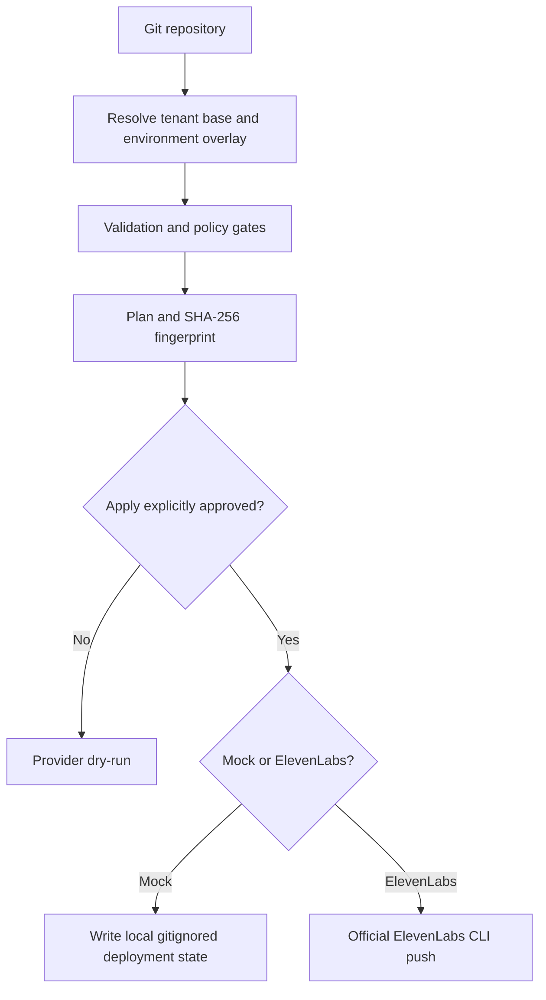

# Architecture

EADK separates **governance config** from **provider agent configs**:

`eadk.json` identifies the project; `tenants/<tenant>/base.json` and `<environment>.json` define deployment metadata. JSON overlay objects merge recursively, lists replace. Project-relative paths are constrained for the ElevenLabs native project directory.

### Trust boundaries

EADK is a **deploy-time policy gate**, not the runtime authorization service. Runtime services remain responsible for identity verification, RBAC, PII redaction, audit logging, payload validation and safe tool execution. Provider CLI is executed as a subprocess without a shell; output is suppressed to limit accidental credential exposure.

### Design decisions

- Standard-library Python only: lightweight, easily audited, no mandatory third-party dependencies.
- Native provider CLI: reduces API schema drift and respects provider-defined agent config semantics.
- Offline mock: can run fully in PR CI without accounts, network, or expenditure.
- Default dry-run: user action required to modify external or local state.
- Never serialize credentials into deployment metadata.
